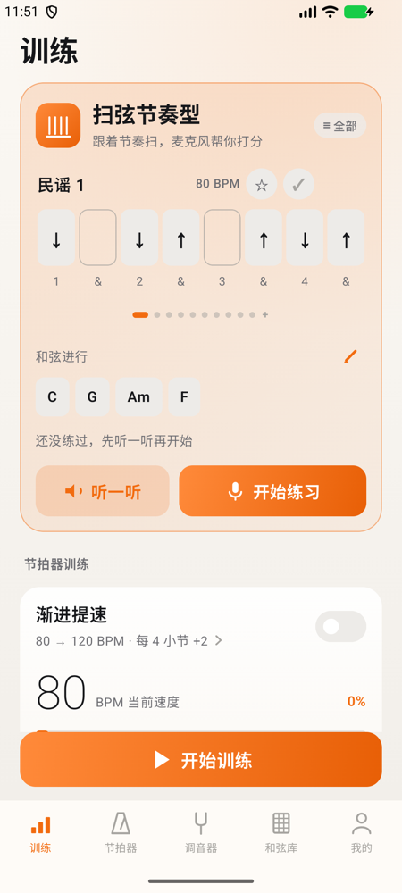
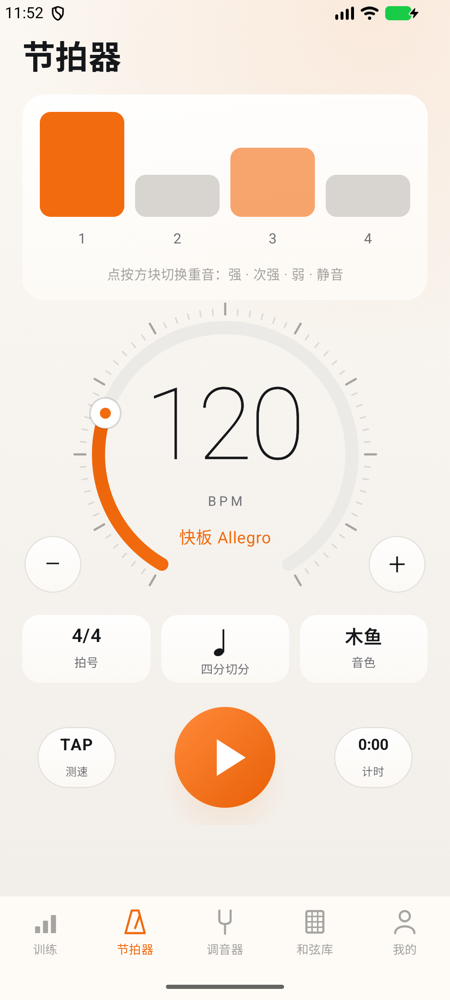
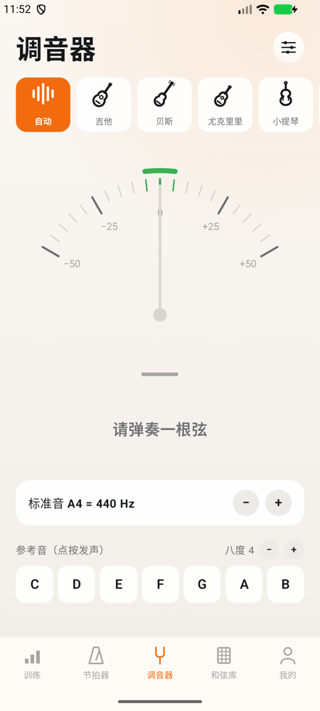
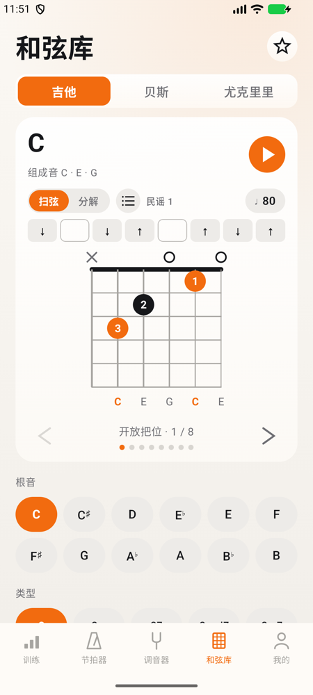

# 调音节拍和弦库 · TuneBeatChord

**给吉他、贝斯、尤克里里玩家用的练琴 App：调音器、节拍器、和弦库，加上能听你弹、逐下打分的扫弦训练。**
iOS 和 Android 两个版本，免费、开源、不联网、不收集任何数据。

[简体中文](#简体中文) · [English](#english)

iOS（深色）：

<p>
  
  
  
  
</p>

Android（浅色）：

<p>
  
  
  
  
</p>

## 简体中文

当前版本：**2.1**（iOS 和 Android 同一个版本号）。

### 下载安装

**Android**（推荐，直接装）

1. 打开 [Releases 页面](https://github.com/aquila0625/TuneBeatChord/releases/latest)，下载 `TuneBeatChord-2.1.apk`。
2. 在手机上点开安装。第一次会提示“允许安装未知来源的应用”，允许浏览器或文件管理器安装即可。
3. 要求 Android 8.0 及以上。第一次进调音器或扫弦练习时，会请求麦克风权限。

想确认下载的文件没被改过，可以核对两个值（都写在 Release 说明里）：

- 文件的 SHA-256：`71330e90a0b0773c7ed8a26553b98a4ea3d91d6fa7d21541f0c72f6029e2525b`
- 签名证书的 SHA-256：`EE:AE:DA:BF:BF:A3:96:D5:69:DF:C1:7A:BF:33:9E:6F:64:F2:C1:11:86:8F:2F:8B:9B:62:D7:B1:20:48:F6:7A`（用 `apksigner verify --print-certs` 查看）

**iOS**

目前没有上架 App Store（上架审核没有通过），需要自己用 Xcode 编译安装，步骤见下面的“编译”。用免费的 Apple ID 就能装到自己的手机，只是这种安装 7 天后需要重新装一次。

### 特色功能

**1. 扫弦训练：听你弹，逐下打分**

- 选乐器（吉他、尤克里里）、和弦进行和节奏型，跟着屏幕上的格子弹。手机通过麦克风听，检测每一下的起音，和该扫的位置对比。
- 每一下分成：**准**（偏差 ±60 毫秒内）、**偏**（±120 毫秒内）、**漏扫**、**多扫**，给出 0 到 100 分的总分。
- 不只是给分，还会告诉你问题出在哪：整体偏快还是偏慢、稳定度如何、该上扫的那几下比下扫慢多少，**每个和弦单独的得分**，以及**换和弦后第一下慢了多少毫秒**（例如“换到 F 时普遍晚了 69 毫秒，可以提前准备按法”）。
- 每件乐器 10 种内置节奏型（民谣、华尔兹、切音、十六分 Funk 等，吉他和尤克里里各有专属的前两个），也可以用 `D`（下扫）`U`（上扫）`X`（闷音）`·`（空拍）写自己的；可以收藏，连续 3 次 90 分以上会建议标记为“已掌握”。
- 和弦进行不限数量：自带 C–G–Am–F、12 小节布鲁斯等常用进行，也可以自己编、保存、拖动排序。
- 先听示范（会倒数一小节再演示），再跟练；外放时不放节拍声，避免被麦克风录进去，戴耳机才会放。有“延迟校准”，补偿不同手机和耳机的延迟。

**2. 节拍器：按采样计时，不会越走越偏**

- 节拍位置按声卡采样数计算，不靠定时器，所以长时间播放也不累计误差；改速度、重音、切分都在下一拍生效，不会卡一下。
- 拍号可自定（分子 1–16），重音可逐拍设为强、次强、弱、静音；8 种切分（八分、三连音、十六分、附点、切分音等）；多种合成音色；TAP 测速。
- **渐进提速**：从起始速度自动加到目标速度，到目标后可以停止、保持或循环。
- **静音小节**：每几小节静音几小节，或者随机静音，训练自己心里的拍子。
- **练习计时**：设一个每天的练习目标，到点提醒。

**3. 调音器：认得出是哪根弦**

- 支持吉他、贝斯、尤克里里、小提琴、中提琴、大提琴和半音阶模式，多种定弦（如 Drop D、DADGAD）。
- 自动识别正在拨的是哪根弦，也可以点一根弦锁定；偏差用音分显示，调准后“叮咚”提示一次。
- 参考音用的是真实乐器的录音，不是电子音；标准音 A4 可调。

**4. 和弦库：10 种和弦类型 × 12 个根音**

- 吉他、尤克里里的指法图（每个和弦有多个把位可以翻页），贝斯显示和弦音的位置。
- 点播放可以听：**扫弦**按节奏型一小节一小节循环，**分解**按指法一根一根弹；两种模式都能编自己的节奏型或分解指法。
- 收藏、左手模式，换乐器时调音器自动切到对应的标准定弦。

**5. 练习记录**

本周练习时长、连续打卡天数、近 7 天柱状图和历史记录，都存在手机本地。

**6. 12 种语言**

简体中文、繁體中文、English、日本語、한국어、Español、Français、Deutsch、Português（巴西）、Italiano、Русский、Türkçe，在 App 里随时切换，不用重启。译文由 AI 生成，欢迎母语者来校对。

### 隐私

- **不联网**：Android 版没有申请联网权限，iOS 版也没有任何网络代码。
- 没有账号、没有内购、没有广告、没有统计，也不收集任何数据。
- 麦克风只用来调音、给扫弦打分（iOS 版还能录制自己的节拍音色），声音在手机上实时分析，不保存、不上传。
- 练习记录和设置只存在手机本地。

### 编译

**iOS**：需要 Xcode 27 和 [XcodeGen](https://github.com/yonaskolb/XcodeGen)。

```bash
cd app
xcodegen generate
open TuneBeatChord.xcodeproj
```

在 Xcode 里选自己的开发团队（Signing & Capabilities），并把 `app/project.yml` 里占位的包名 `com.example.tunebeatchord` 改成你自己的（例如 `com.你的名字.tunebeatchord`），再运行到手机上。

**Android**：需要 JDK 17 以上（Android Studio 自带的就行）和 Android SDK。原生 Kotlin + Jetpack Compose，不需要 NDK。

```bash
cd android
echo "sdk.dir=$HOME/Library/Android/sdk" > local.properties
./gradlew :app:assembleDebug        # app/build/outputs/apk/debug/app-debug.apk
./gradlew :app:testDebugUnitTest    # 单元测试
```

自己发布时，把 `android/app/build.gradle.kts` 里的 `applicationId` 改成自己的，并用自己的密钥签名（仓库里没有任何密钥）。

### 目录

| 路径 | 内容 |
|---|---|
| `app/` | iOS App（SwiftUI）和节拍引擎 `MetronomeCore`，详见 `app/README.md` |
| `android/` | Android App（Kotlin、Jetpack Compose），按 iOS 的逻辑移植，详见 `android/README.md` |
| `Packages/TunerKit` | 音高检测、定弦和调音器界面（iOS） |
| `Packages/ChordKit` | 和弦乐理、指法生成、和弦试听和和弦库界面（iOS） |
| `Packages/PracticeKit` | 节奏类型、训练方案和练习记录（iOS） |

### 已知限制

- Android 版比 iOS 版新：在一台 Android 14 真机和模拟器上验证过，但**麦克风收音的实际准确度（调音、扫弦起音检测）和各机型的延迟补偿还没有大范围验证**；还没做的功能（后台继续响和通知栏控制、人声报数音色、耳机拔出自动暂停等）列在 `android/README.md`。
- 扫弦评分只看时间，不判断实际是上扫还是下扫；很吵的环境、手机离琴很远时会漏检。
- iOS 版目前没有上架，需要自己编译。

### 参与

发现问题、想加功能，欢迎在 [Issues](https://github.com/aquila0625/TuneBeatChord/issues) 里提；译文校对、不同机型上的测试反馈尤其有帮助。

### 许可证

代码采用 [Apache License 2.0](LICENSE)。`Packages/TunerKit` 里的乐器采样沿用各自的授权（CC0 和爱荷华大学 MIS 的条款），见 [NOTICE](NOTICE) 和 `Packages/TunerKit/Sounds/LICENSES.md`。

## English

**TuneBeatChord** is a free, open-source practice app for guitar, bass and ukulele players, for iOS and Android: a tuner, a metronome, a chord library, and strum training that listens to you play and scores every stroke. It has no accounts, no purchases, no ads, no analytics and no network access. Current version: **2.1**.

### Download

- **Android**: get `TuneBeatChord-2.1.apk` from the [latest release](https://github.com/aquila0625/TuneBeatChord/releases/latest) (Android 8.0 or newer; you need to allow installing from your browser or file manager). SHA-256 of the file: `71330e90a0b0773c7ed8a26553b98a4ea3d91d6fa7d21541f0c72f6029e2525b`. Signing certificate SHA-256: `EE:AE:DA:BF:BF:A3:96:D5:69:DF:C1:7A:BF:33:9E:6F:64:F2:C1:11:86:8F:2F:8B:9B:62:D7:B1:20:48:F6:7A`.
- **iOS**: not on the App Store (it did not pass review), so build it yourself with Xcode (see below). A free Apple ID is enough to install it on your own phone; such installs expire after 7 days.

### Highlights

- **Strum training that scores every stroke.** Pick an instrument, a chord progression and a strumming pattern and play along. The microphone detects each stroke and compares it with the beat: **on time** (within ±60 ms), **off** (within ±120 ms), **missed** or **extra**, for a score from 0 to 100. The result also tells you what to fix: how early or late you are, how steady, how much later your up-strokes are than your down-strokes, a **score for each chord**, and **how many milliseconds late the first stroke after each chord change is**.
- **10 built-in strumming patterns per instrument** plus your own, written with `D` (down), `U` (up), `X` (muted) and `·` (rest). Favourites, a "mastered" mark, unlimited chord progressions with common presets, a demo mode and latency calibration.
- **A metronome that does not drift.** Beats are placed by audio sample count, not by timers. Custom time signatures, per-beat accents, 8 subdivisions, several click sounds, tap tempo, **gradual speed-up**, **muted-bar and random-mute training**, and a daily practice timer with a reminder.
- **A tuner that knows which string you are playing.** Guitar, bass, ukulele, violin, viola, cello and chromatic mode, with alternate tunings such as Drop D and DADGAD, string auto-detection or lock, cents display, and reference tones from real instrument recordings.
- **A chord library**: 10 chord types × 12 roots, voicing charts for guitar and ukulele with several positions each, chord-tone positions for bass, playback as strumming or arpeggio, custom patterns, favourites and a left-handed mode.
- **A practice log** (weekly time, streaks, history) stored only on the device, and **12 languages**: Simplified and Traditional Chinese, English, Japanese, Korean, Spanish, French, German, Brazilian Portuguese, Italian, Russian and Turkish (machine-translated; corrections from native speakers are welcome).

### Privacy

No network permission on Android and no network code on iOS. No accounts, purchases, ads or analytics. The microphone is used only for tuning and scoring your strumming (and, on iOS, recording your own metronome sound); audio is analyzed live on the device and never stored or sent anywhere.

### Building

**iOS.** You need Xcode 27 and [XcodeGen](https://github.com/yonaskolb/XcodeGen).

```bash
cd app
xcodegen generate
open TuneBeatChord.xcodeproj
```

Choose your own team in Xcode and replace the placeholder bundle ID `com.example.tunebeatchord` in `app/project.yml`.

**Android.** You need JDK 17 or newer (the one bundled with Android Studio works) and the Android SDK. Native Kotlin with Jetpack Compose, no NDK.

```bash
cd android
echo "sdk.dir=$HOME/Library/Android/sdk" > local.properties
./gradlew :app:assembleDebug
./gradlew :app:testDebugUnitTest
```

To publish your own build, change `applicationId` in `android/app/build.gradle.kts` and sign with your own key (there are no keys in this repository).

### Layout

| Path | Contents |
|---|---|
| `app/` | The iOS app (SwiftUI) and the `MetronomeCore` audio engine package. See `app/README.md`. |
| `android/` | The Android app (Kotlin, Jetpack Compose), ported from the iOS logic. See `android/README.md`. |
| `Packages/TunerKit` | Pitch detection, tunings and the tuner UI (iOS) |
| `Packages/ChordKit` | Chord theory, voicing generation, chord playback and the chord library UI (iOS) |
| `Packages/PracticeKit` | Rhythm types, training plans and practice records (iOS) |

The docs inside the repository are written in Chinese.

### Known limitations

- The Android app is newer than the iOS app. It has been tried on one Android 14 phone and an emulator, but microphone accuracy (tuning, strum onset detection) and latency compensation have not been verified widely. Missing features are listed in `android/README.md`.
- Strum scoring looks at timing only; it does not tell down-strokes from up-strokes. Noisy rooms and a phone far from the guitar cause missed strokes.

### License

The code is licensed under the [Apache License 2.0](LICENSE). The instrument samples in `Packages/TunerKit` keep their own terms (CC0 and the University of Iowa MIS terms); see [NOTICE](NOTICE) and `Packages/TunerKit/Sounds/LICENSES.md`.
