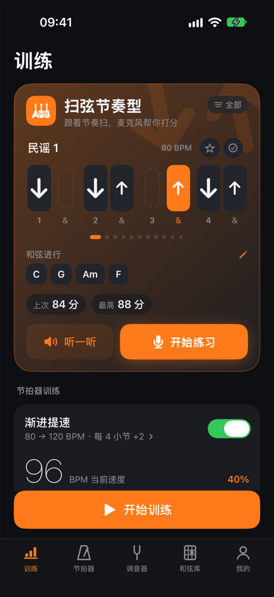
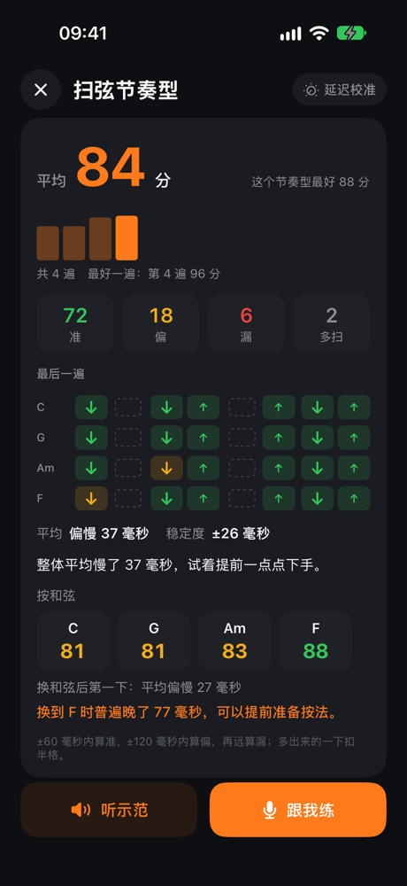
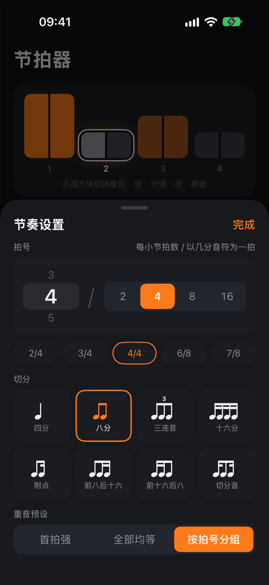
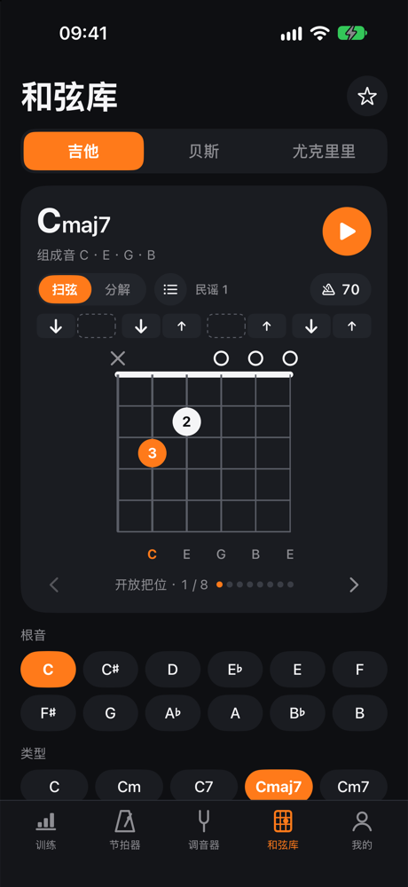

# TuneBeatChord / 调音节拍和弦库

[English](#english) · [简体中文](#简体中文)

<p>
  
  
  
  
</p>

## English

TuneBeatChord is a practice app for guitar, bass and ukulele players, for iOS and Android. It has a tuner, a metronome and a chord library, plus strum training that listens through the microphone, scores every stroke against the rhythm and tells you where your timing slips.

Everything runs on the device. The app has no accounts, no in-app purchases, no network access and no analytics.

### Features

- **Tuner**: guitar, bass, ukulele, violin family and chromatic mode, with reference tones from real instrument recordings.
- **Metronome**: sample-accurate scheduling with no drift; accents, 8 subdivisions, several click sounds, tap tempo, gradual speed-up and muted-bar training.
- **Chord library**: chord charts for guitar, ukulele and bass, with playback, arpeggio and strumming patterns, favourites and a left-handed mode.
- **Strum training**: pick an instrument, a chord progression and a strumming pattern, then play along. Each stroke is scored as on time (±60 ms), off (±120 ms), missed or extra. The result shows down-stroke and up-stroke offsets, a score for each chord, and how late the first stroke after each chord change is.
- **Practice log**: weekly time, streaks and history, stored on the device (SwiftData on iOS, local files on Android).
- **12 languages**: Simplified and Traditional Chinese, English, Japanese, Korean, Spanish, French, German, Brazilian Portuguese, Italian, Russian and Turkish. The translations were machine-generated, so corrections from native speakers are welcome.

### Building

**iOS.** You need Xcode 27 and [XcodeGen](https://github.com/yonaskolb/XcodeGen).

```bash
cd app
xcodegen generate
open TuneBeatChord.xcodeproj
```

To run on a device, set your own team in Xcode and replace the placeholder bundle ID `com.example.tunebeatchord` in `app/project.yml`.

**Android.** You need JDK 17 or newer (the one bundled with Android Studio works) and the Android SDK. The app is native Kotlin with Jetpack Compose, with no NDK.

```bash
cd android
echo "sdk.dir=$HOME/Library/Android/sdk" > local.properties
./gradlew :app:assembleDebug     # app/build/outputs/apk/debug/app-debug.apk
./gradlew :app:testDebugUnitTest
```

The Android port follows the iOS behavior but is younger: a few features are not done yet, and the microphone paths have not been verified on a real device. See `android/README.md` for the list.

### Layout

| Path | Contents |
|---|---|
| `app/` | The iOS app (SwiftUI) and the `MetronomeCore` audio engine package. See `app/README.md`. |
| `android/` | The Android app (Kotlin, Jetpack Compose), ported from the iOS logic. See `android/README.md`. |
| `Packages/TunerKit` | Pitch detection, tunings and the tuner UI |
| `Packages/ChordKit` | Chord theory, voicing generation, chord playback and the chord library UI |
| `Packages/PracticeKit` | Rhythm types, training plans and practice records (SwiftData) |

The docs inside the repository are written in Chinese.

### License

The code is licensed under the [Apache License 2.0](LICENSE). The instrument samples in `Packages/TunerKit` keep their own terms (CC0 and the University of Iowa MIS terms); see [NOTICE](NOTICE) and `Packages/TunerKit/Sounds/LICENSES.md`.

## 简体中文

调音节拍和弦库是一个给吉他、贝斯、尤克里里玩家用的练琴 App，有 iOS 和 Android 两个版本：调音器、节拍器、和弦库都有，另外还有扫弦训练，通过麦克风听你弹，按节奏逐下打分，告诉你哪里快了、哪里慢了。

所有功能都在手机上完成。App 没有账号、没有内购、不联网，也不做任何统计。

### 功能

- **调音器**：支持吉他、贝斯、尤克里里、提琴类和半音阶模式，参考音用真实乐器录音。
- **节拍器**：按采样调度，不会累计漂移；可调重音，有 8 种切分、多种音色和 TAP 测速，还有渐进提速和静音小节训练。
- **和弦库**：吉他、尤克里里、贝斯的指法图，可以试听，有分解和扫弦节奏型、收藏和左手模式。
- **扫弦训练**：选乐器、和弦进行和节奏型，跟着弹。每一下都会打分：准（±60 毫秒）、偏（±120 毫秒）、漏扫或多扫。结果里有下扫和上扫的偏差、每个和弦的得分，以及换和弦后第一下慢了多少。
- **练习记录**：本周时长、连续打卡和历史记录，存在本机（iOS 用 SwiftData，安卓用本地文件）。
- **12 种语言**：简体中文、繁體中文、English、日本語、한국어、Español、Français、Deutsch、Português（巴西）、Italiano、Русский、Türkçe。译文由 AI 生成，欢迎母语者校对。

### 编译

**iOS**：需要 Xcode 27 和 [XcodeGen](https://github.com/yonaskolb/XcodeGen)。

```bash
cd app
xcodegen generate
open TuneBeatChord.xcodeproj
```

装到真机前，在 Xcode 里选自己的开发团队，并把 `app/project.yml` 里占位的包名 `com.example.tunebeatchord` 改成你自己的。

**Android**：需要 JDK 17 以上（Android Studio 自带的就行）和 Android SDK。原生 Kotlin + Jetpack Compose，不需要 NDK。

```bash
cd android
echo "sdk.dir=$HOME/Library/Android/sdk" > local.properties
./gradlew :app:assembleDebug     # app/build/outputs/apk/debug/app-debug.apk
./gradlew :app:testDebugUnitTest
```

安卓版的行为和 iOS 一致，但做得比较新：有几项功能还没做，麦克风相关的部分也没在真机上验证过，清单见 `android/README.md`。


### 目录

| 路径 | 内容 |
|---|---|
| `app/` | iOS App（SwiftUI）和节拍引擎 `MetronomeCore`，详见 `app/README.md` |
| `android/` | 安卓 App（Kotlin、Jetpack Compose），按 iOS 的逻辑移植，详见 `android/README.md` |
| `Packages/TunerKit` | 音高检测、定弦和调音器界面 |
| `Packages/ChordKit` | 和弦乐理、指法生成、和弦试听和和弦库界面 |
| `Packages/PracticeKit` | 节奏类型、训练方案和练习记录（SwiftData） |

### 许可证

代码采用 [Apache License 2.0](LICENSE)。`Packages/TunerKit` 里的乐器采样沿用各自的授权（CC0 和爱荷华大学 MIS 的条款），见 [NOTICE](NOTICE) 和 `Packages/TunerKit/Sounds/LICENSES.md`。
